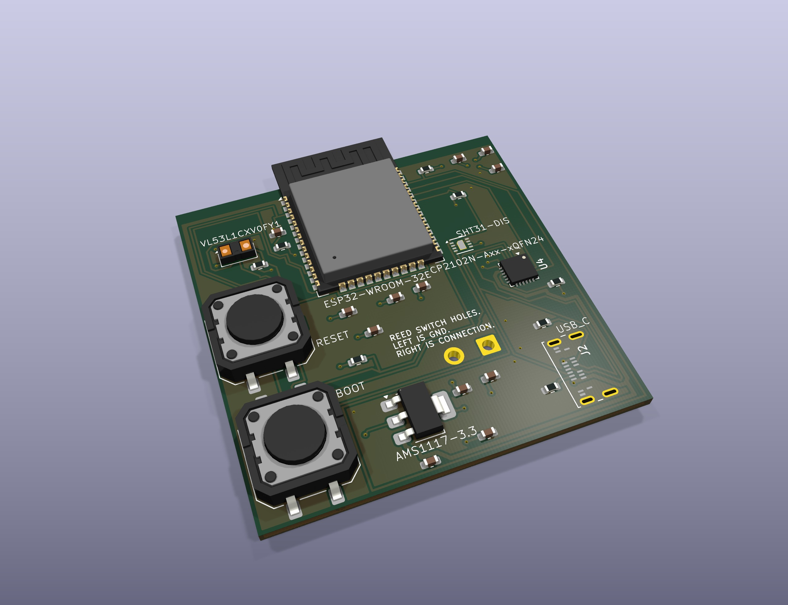
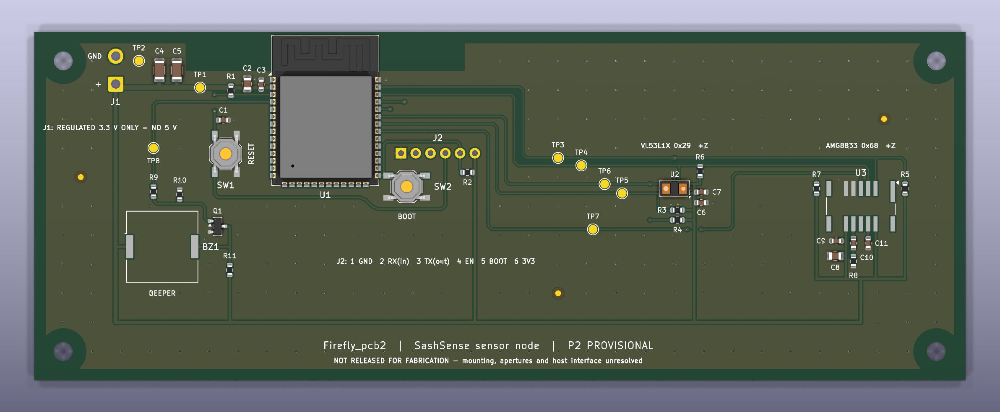

# SashSense

SashSense monitors fume hood sash position and whether someone is working at the hood. It is designed to beep when a user walks away and leaves the sash open. The wider project is working toward deployment across 191 UW fume hoods, supported by a UW STF Green Building Award.

I selected sensors, tested breadboard circuits, designed PCBs and built earlier ESP32 prototypes. I also coordinate the team's technical work.

The in-hood node measures sash opening and temperature/humidity. The presence node uses VL53L1X and an AMG8833 thermopile array; it builds on SEAL's Firefly human-presence project.

## Schematics and PCB previews

| Board | Schematic | 3D PCB |
| --- | --- | --- |
| Node 1 | [JPG](previews/SashSense_node1_schematic.jpg) | [JPG](previews/SashSense_node1_pcb_3d.jpg) |
| Node 2 | [JPG](previews/SashSense_node2_schematic.jpg) | [JPG](previews/SashSense_node2_pcb_3d.jpg) |

The PCB previews are CAD renders; some component models are missing.

## Node 1 — in-hood board

Open `SashSense_node1.kicad_pro` in KiCad 10. The matching schematic and board use the same filename stem.

*CAD render, not a hardware photograph.*

[Node 1 schematic](SashSense_node1.pdf)

This earlier revision contains ESP32-WROOM-32E, SHT31, USB-C, CP2102N and AMS1117-3.3. Its distance sensor is a VL53L1X.

## Node 2 — presence-board reconstruction

Open [SashSense_node2/Firefly_pcb2.kicad_pro](SashSense_node2/Firefly_pcb2.kicad_pro). The circuit uses ESP32-S3-WROOM-1-N8, VL53L1X, AMG8833 and a transistor-driven piezo beeper. Project-local symbols, footprints, layout builders and verification scripts are included.

*CAD render of the complete 160 × 60 mm board, not a hardware photograph. Some part models are absent.*

The outline was first drawn as a provisional 500 × 500 mm board and has since been trimmed to the populated area; placement and routing did not change. Sensor positions and the four corner mounting holes are provisional. Placement and routing decisions are documented in the layout review below.

[Node 2 schematic](SashSense_node2/outputs/Firefly_pcb2_schematic.pdf) · [Layout review](SashSense_node2/docs/pcb_layout_review.md) · [Open, check and regenerate](SashSense_node2/README.md)

## Current checks and unfinished work

Saved KiCad 10.0.5 check results:

| Check | Node 1 | Firefly node 2 |
| --- | --- | --- |
| ERC errors/warnings | 0 / 0 | 0 / 0 |
| Configured DRC findings | 1 | 0 |
| Unconnected items | 0 | 0 |
| Configured schematic/PCB parity issues | 0 | 0 |

A stricter check reports 24 footprint-filter metadata mismatches. The generator needs that fix before schematic regeneration. Script-check results and the stricter-check details are in the [layout review](SashSense_node2/docs/pcb_layout_review.md).

Neither revision is released for fabrication. Node 1's one DRC finding is its ESP32 footprint differing from KiCad's library copy (0.3 mm instead of 0.2 mm thermal vias), kept on purpose. Firefly needs confirmed beeper sourcing, mounting and optical openings, a regulated 3.3 V harness, and a fabricator DFM review. It has no hardware bring-up or deployment result yet.

The root reports describe Node 1; Firefly reports are under `SashSense_node2/reports/`.
