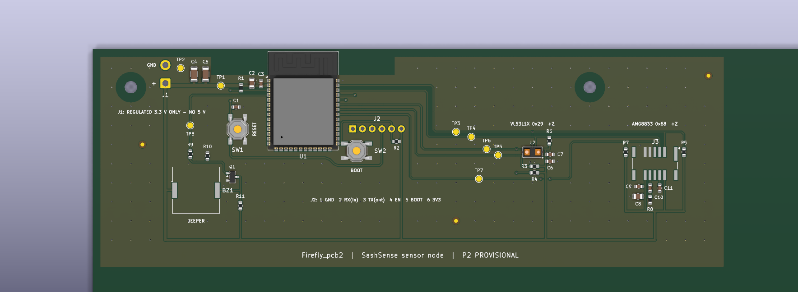

# SashSense

SashSense monitors fume hood sash position and whether someone is working at the hood. It beeps when a user walks away and leaves the sash open. Deployment to 191 UW fume hoods is in progress, supported by a UW STF Green Building Award.

My work includes sensor selection, breadboard testing, circuit and PCB design, building the earlier ESP32 node prototypes, and coordinating the team's technical work.

The in-hood node measures sash opening and temperature/humidity. The presence node uses VL53L1X and an AMG8833 thermopile array. This repository contains the surviving in-hood revision and a new, unbuilt reconstruction of the presence node.

## Node 1 — in-hood board

Open `SashSense_node1.kicad_pro` in KiCad 10. The matching schematic and board use the same filename stem. These files were renamed from `PCB_FUMEHOODS`; their native CAD contents and circuit connectivity are unchanged.

[Node 1 schematic](SashSense_node1.pdf)

This earlier revision contains ESP32-WROOM-32E, SHT31, USB-C, CP2102N and AMS1117-3.3. It labels the distance sensor VL53L0X-family, while the current system specifies VL53L1X; the part and footprint still need to be reconciled.

## Node 2 — presence-board reconstruction

Open [SashSense_node2/Firefly_pcb2.kicad_pro](SashSense_node2/Firefly_pcb2.kicad_pro). The circuit uses ESP32-S3-WROOM-1-N8, VL53L1X, AMG8833 and a transistor-driven piezo beeper. Project-local symbols, footprints, layout builders and verification scripts are included.

*CAD render of the populated area, not a hardware photograph. Some part models are absent. The full provisional board is 500 × 500 mm; [full-board view](SashSense_node2/outputs/previews/Firefly_pcb2_3D_top_full.png).*

The layout uses six short bottom-layer crossings to accommodate the fixed GPIO order, with the rest of the routing on top. The antenna keepout is clear on both copper layers. Sensor positions, 25 support holes and three fiducials are provisional.

[Node 2 schematic](SashSense_node2/outputs/Firefly_pcb2_schematic.pdf) · [Layout review](SashSense_node2/docs/pcb_layout_review.md) · [Open, check and regenerate](SashSense_node2/README.md)

## JPG files

| Board | Schematic | 3D PCB |
| --- | --- | --- |
| Node 1 | [JPG](previews/SashSense_node1_schematic.jpg) | [JPG](previews/SashSense_node1_pcb_3d.jpg) |
| Node 2 | [JPG](previews/SashSense_node2_schematic.jpg) | [Close-up](previews/SashSense_node2_pcb_3d.jpg) · [Full board](previews/SashSense_node2_pcb_3d_full.jpg) |

These are exports of the saved KiCad designs. The 3D views are CAD renders; some component body models are absent. Node 2's close-up shows the populated corner of its provisional 500 × 500 mm board.

## Current checks and unfinished work

Fresh checks used KiCad 10.0.5:

| Check | Node 1 | Firefly node 2 |
| --- | --- | --- |
| ERC errors/warnings | 0 / 0 | 0 / 0 |
| Configured DRC findings | 10 | 0 |
| Unconnected items | 9 | 0 |
| Configured schematic/PCB parity issues | 0 | 0 |

Firefly also passed 186 schematic, 527 board and 25 exported-artifact checks. Enabling five normally ignored checks in a scratch project produced 0 DRC violations and 24 footprint-filter metadata parity mismatches. The generator needs that metadata fix before schematic regeneration.

Neither revision is released for fabrication. Node 1 needs its clearance, connectivity and sensor-revision issues resolved. Firefly needs confirmed beeper sourcing, mounting and optical openings, a regulated 3.3 V harness, and an assembly/DFM route for a 500 mm board. It has no hardware bring-up or deployment result yet.

The root reports describe Node 1; Firefly reports are under `SashSense_node2/reports/`. Original local files and Git history are preserved. This repository remains private.
